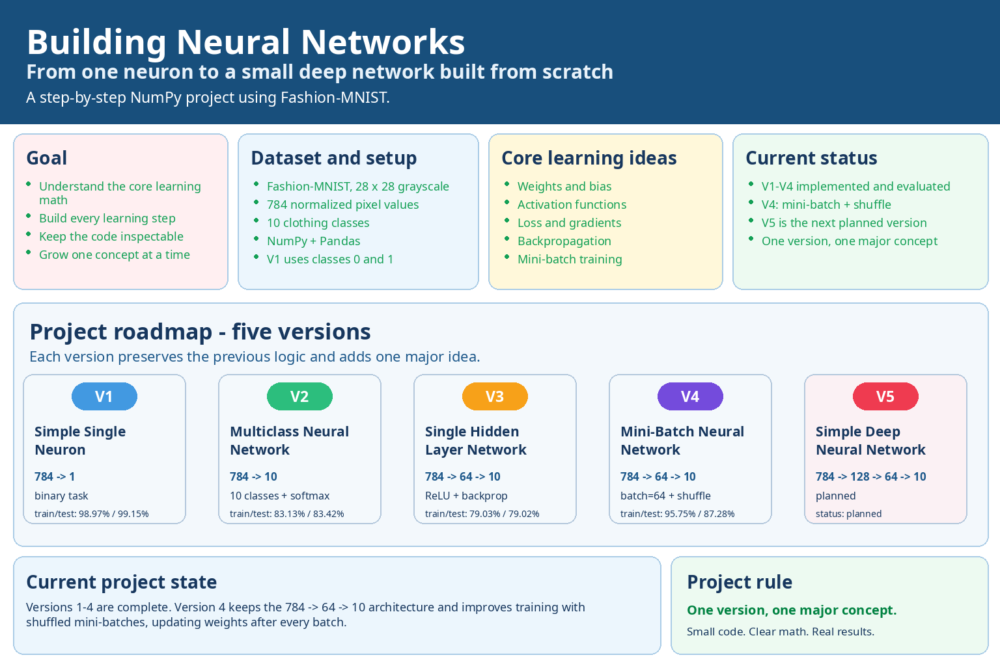

# Building Neural Networks

A progressive educational project that shows how to build **neural networks from scratch**, starting from a single neuron for binary classification and evolving step by step toward multiclass classification, hidden layers, backpropagation, mini-batch training and a simple deep neural network.

The project uses the **Fashion-MNIST dataset** as a constant practical laboratory. Keeping the same dataset across the main multiclass versions makes each architectural and training change easier to inspect and compare.

The implementation intentionally avoids ready-made neural-network estimators. Weighted sums, activations, loss functions, analytical gradients, backpropagation, parameter updates and mini-batch training are implemented directly with **NumPy, Pandas and Matplotlib** so that the mechanics remain visible.

Version 5 completes the original five-stage roadmap with a simple deep neural network containing two hidden layers.

  [](LICENSE) [](https://www.kaggle.com/code/lucalullo/building-neural-networks)

[Kaggle notebook](https://www.kaggle.com/code/lucalullo/building-neural-networks) · [GitHub repository](https://github.com/lucalullo/building-neural-networks) · [Technical report](project-report-en.pdf)



## Overview

The project follows one main principle:

> **One version, one major concept.**

Version 1 introduces a **Simple Single Neuron**:

1. reduce Fashion-MNIST to two classes;
2. flatten each image into 784 input features;
3. normalize pixel values;
4. compute a weighted input with weights and bias;
5. apply the sigmoid activation;
6. measure binary cross-entropy loss;
7. compute analytical gradients;
8. update parameters with gradient descent;
9. convert the final output into a binary prediction.

Version 2 adds **Multiclass Classification**:

## Current capabilities

- load the Fashion-MNIST training and test CSV datasets;
- flatten each 28×28 image into 784 input features;
- normalize pixel values from `0-255` to `0-1`;
- one-hot encode multiclass targets;
- initialize neural-network weights directly;
- compute weighted sums and biases;
- apply sigmoid and ReLU activations;
- compute numerically stable softmax probabilities;
- calculate binary and multiclass cross-entropy;
- perform forward propagation through multiple parameterized layers;
- compute analytical gradients;
- backpropagate gradients through hidden layers;

## Architecture

```text
Fashion-MNIST CSV Data
    ↓
Pixel Features
28 × 28 → 784 values
    ↓
Normalization
0-255 → 0-1
    ↓
One-Hot Targets
10 classes
    ↓
Input Layer
784 features
    ↓
Hidden Layer 1
128 neurons + ReLU
    ↓
Hidden Layer 2
64 neurons + ReLU
    ↓
Output Layer
10 neurons
    ↓
Softmax
class probabilities
    ↓
Multiclass Cross-Entropy
    ↓
Backpropagation
output layer
    ↓
Backpropagation
hidden layer 2
    ↓
Backpropagation
hidden layer 1
    ↓
Mini-Batch Parameter Updates
    ↓
Repeat Across Epochs
    ↓
Argmax
    ↓
Fashion-MNIST Prediction
```

The key transition in Version 5 is that backpropagation no longer passes through only one hidden representation. Gradients are propagated through two hidden layers, allowing the project to demonstrate the mechanics of a deeper network while keeping every calculation explicit.

## Version guide

| Version | Focus | Notebook and resources |
|---:|---|---|
| 1 | Simple Single Neuron | [`v1-simple-single-neuron/`](v1-simple-single-neuron/) |
| 2 | Multiclass Neural Network | [`v2-multiclass-neural-network/`](v2-multiclass-neural-network/) |
| 3 | Single Hidden Layer Network | [`v3-single-hidden-layer-network/`](v3-single-hidden-layer-network/) |
| 4 | Mini-Batch Neural Network | [`v4-mini-batch-neural-network/`](v4-mini-batch-neural-network/) |
| 5 | Simple Deep Neural Network | [`v5-simple-deep-neural-network/`](v5-simple-deep-neural-network/) |

### What each version introduces

<details>
<summary>Version 1 - Simple Single Neuron</summary>

Version 1 establishes the complete learning loop with a single neuron.

Fashion-MNIST is reduced to a binary classification problem using only:

- one neuron;
- weighted input `X @ w + b`;
- sigmoid activation;
- binary cross-entropy loss;
- gradient descent;

</details>

<details>
<summary>Version 2 - Multiclass Neural Network</summary>

Version 2 extends the model to all **10 Fashion-MNIST classes**.

The single output neuron becomes a linear output layer with 10 neurons. The model introduces:

- one-hot encoded targets;
- 10 output neurons;
- numerically stable softmax;
- multiclass cross-entropy;
- full-batch gradient descent;

</details>

<details>
<summary>Version 3 - Single Hidden Layer Network</summary>

Version 3 introduces the first non-linear hidden representation.

The implementation explicitly computes every gradient needed to update both layers.

- a 64-neuron hidden layer;
- ReLU activation;
- He-style random weight initialization;
- forward propagation through multiple layers;
- backpropagation through the output and hidden layers;

</details>

<details>
<summary>Version 4 - Mini-Batch Neural Network</summary>

Version 4 keeps the same one-hidden-layer architecture but changes how the model is trained.

This is a major practical step toward the training loop used by modern neural networks.

- random shuffling at the start of each epoch;
- mini-batches of 64 samples;
- forward propagation per mini-batch;
- backpropagation per mini-batch;
- parameter updates after every batch;

</details>

<details>
<summary>Version 5 - Simple Deep Neural Network</summary>

Version 5 adds a second hidden layer and propagates gradients through the complete network.

It combines the ideas developed in the earlier versions:

- normalized image inputs;
- one-hot targets;
- He-style initialization;
- ReLU hidden activations;
- softmax output probabilities;

</details>

## Results

| Version | Model | Train accuracy | Test accuracy |
|---|---|---:|---:|
| V1 | Single neuron, binary | 98.97% | 99.15% |
| V2 | Linear multiclass network | 83.13% | 83.42% |
| V3 | One hidden layer, full-batch | 79.03% | 79.02% |
| V4 | One hidden layer, mini-batch | 95.75% | 87.28% |
| V5 | Two hidden layers, mini-batch | 99.59% | 89.92% |

The Version 1 result is not directly comparable with Versions 2-5 because it uses only two Fashion-MNIST classes, while the remaining versions solve the full 10-class problem.

The project is intentionally educational rather than benchmark-oriented, so the architectures and hyperparameters are kept simple and the versions are designed primarily to expose one new concept at a time.

## Getting started

### Requirements

- Python 3
- Jupyter Notebook or JupyterLab
- NumPy
- pandas
- Matplotlib
- Fashion-MNIST CSV training and test data

The notebooks were developed for the Kaggle Fashion-MNIST dataset environment and currently read the files from:

```python
PATH = "/kaggle/input/datasets/zalando-research/fashionmnist/"
```

Expected files:

```text
fashion-mnist_train.csv
fashion-mnist_test.csv
```

To run locally, install the required libraries:

```bash
pip install numpy pandas matplotlib jupyter
```

Clone the repository:

```bash
git clone <repository-url>
cd building-neural-networks
```

Start Jupyter Notebook:

```bash
jupyter notebook
```

Download the Fashion-MNIST CSV dataset, then update the `PATH` variable in the notebook to point to its local directory.

Open the version you want to study and run the cells in order.

For example, to study the final deep neural network implementation:

```text
v5-simple-deep-neural-network/building-neural-networks.ipynb
```

The dataset itself is not included in this repository.

## Repository structure

Each version is kept in its own folder with the corresponding notebook and, where available, version-specific diagrams and reports.

## Documentation

- [Project report (English)](project-report-en.pdf)
- [Relazione del progetto (Italiano)](project-report-it.pdf)
- [Project infographic](infographic.png)

## Limitations

- the implementation is written for clarity rather than computational efficiency;
- neural-network layers are implemented directly with matrix operations rather than framework APIs;
- training loops are intentionally explicit;
- hyperparameters are manually selected rather than tuned systematically;
- there is no validation split or cross-validation;
- there is no regularization such as dropout or weight decay;
- there are no convolutional layers, even though Fashion-MNIST is an image dataset;
- there are no adaptive optimizers such as Adam or RMSprop;
- there is no learning-rate scheduling;

## Project status

**Building Neural Networks is complete according to the V1-V5 structure originally planned for the project.**

The repository now contains the full educational path from a single binary neuron to a simple deep neural network trained with mini-batch gradient descent and backpropagation.

Version 1 establishes the basic learning loop with sigmoid activation, binary cross-entropy and analytical gradients.

## License

Distributed under the [MIT License](LICENSE).

## Author

Created by [Luca Lullo](https://github.com/lucalullo).
